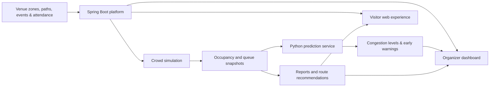

<div align="center">


# MERGAB | مرقاب

### Predict the crowd. Simulate the response. Improve the experience.

**An intelligent crowd-management prototype designed for the visitor experience at Expo Riyadh 2030.**

**مرقاب — منصة ذكية لرصد حركة الحشود، والتنبؤ بالازدحام، ومحاكاة القرارات التشغيلية في إكسبو الرياض 2030.**


**Team OMINX · Expo 2030 Challenge**

</div>

---

## Overview

Large exhibitions bring together visitors, events, facilities, and interconnected walking routes. When attendance rises around a popular event or a busy entrance, congestion can spread between zones before operators have enough time to respond.

**Mergab** brings crowd visibility, operational simulation, and visitor navigation into one system. It helps organizers understand occupancy, explore possible crowd-flow scenarios, and identify potential congestion, while giving visitors an easier way to explore the venue.

The project focuses on a central idea: **move from reacting to congestion to anticipating it.**

## The Challenge & Our Approach

| Challenge | Mergab's approach |
| --- | --- |
| Congestion around popular areas and events | Zone-level occupancy tracking and congestion forecasting |
| Operational decisions made with limited visibility | Event-aware crowd simulations and minute-by-minute results |
| Visitors moving through interconnected, capacity-limited areas | Zone connections, routes, and congestion-aware route recommendations |
| Difficulty finding facilities and activities | An interactive venue map with facilities, events, and navigation tools |
| Visitor flows changing around prayer times | Prayer-time information and prayer-aware simulation logic |

## Key Features

### For Expo Organizers

- **Operations dashboard:** View zone occupancy, upcoming events, crowd indicators, and early-warning information.
- **Zone management:** Configure zone capacities, initial visitor counts, and map boundaries.
- **Connected venue map:** Define connections and walking paths between zones, including flow-capacity constraints.
- **Event management:** Associate events with zones, schedules, and expected attendance.
- **Crowd simulation:** Model arrivals, movement, queues, and occupancy over time; generate per-zone simulation snapshots.
- **Scenario exploration:** Run and continue simulations to study changes in crowd conditions over time.
- **Congestion forecasting:** Request short-horizon occupancy predictions and classify congestion risk.
- **Early warnings:** Review zone-level forecasts with risk indicators and suggested responses.
- **Intervention management:** Record operational interventions and associate them with simulations.
- **Reports and analytics:** Explore occupancy timelines, peak activity, and downloadable CSV results.
- **Visitor check-in:** Use visitor QR tokens to register zone entry and exit and review active visits.

### For Expo Visitors

- **Interactive Expo map:** Explore the venue, its zones, pathways, and facilities.
- **Discover events:** Browse scheduled activities, their locations, and relevant venue information.
- **Find nearby facilities:** Locate services such as restrooms and prayer rooms using map positions or geographic coordinates.
- **Route recommendations:** Request a route and, where available, an alternative based on the venue's connected zones and simulation data.
- **Personal visitor QR code:** Access a QR code in the visitor account for attendance check-in.
- **Prayer-time support:** View daily prayer times for Riyadh and user-specific prayer alerts.
- **Arabic and English interface:** Navigate visitor pages with bilingual UI support.

### Platform & Access

- Role-based accounts for **Admin**, **Organizer**, and **Visitor**.
- Authentication and password hashing with Spring Security and BCrypt.
- Email-based registration and password-recovery support.
- REST APIs used by the web interfaces and simulation services.

## How Mergab Works



1. **Model the venue:** Define zones, capacities, boundaries, and connections.
2. **Provide operational inputs:** Add events, historical attendance references, and initial occupancy values.
3. **Simulate movement:** Calculate zone occupancy and queues across a time-based scenario.
4. **Assess congestion:** Use prediction results and warning indicators to identify areas that may become crowded.
5. **Support decisions:** Inspect reports, consider interventions, and help visitors navigate the venue.

## Data & AI

Mergab's data pipeline combines:

- **Historical attendance context**, including data gathered by the team from Expo Osaka.
- **Venue configuration:** zones, capacities, connections, and mapped facilities.
- **Event information:** dates, locations, and expected demand.
- **Visitor activity:** QR-based check-in/check-out and zone occupancy records.
- **Simulation outputs:** time-indexed occupancy and queue-length snapshots.
- **Prayer times:** retrieved through the AlAdhan API, with a fallback for service outages.

The team has developed AI models using historical Expo Osaka data. The version of the Python/FastAPI service currently included in this archive is available in [`mirqab-ai/`](mirqab-ai/): its packaged `/predict` endpoint estimates occupancy over a configurable horizon and returns **LOW**, **MEDIUM**, or **HIGH** congestion levels. The Spring Boot backend also exposes early-warning and analysis integration endpoints.

> **Prototype note:** The packaged `/predict` implementation uses a snapshot-trend baseline; the team's trained-model work and additional AI features are not fully represented by the files in this archive. The final README will document the merged AI implementation and recorded evaluation metrics. No accuracy percentage is claimed without a recorded evaluation.

## Technology Stack

| Layer | Technologies |
| --- | --- |
| Backend | Java 17, Spring Boot 4.1.1, Spring MVC, Spring Data JPA |
| Frontend | HTML, CSS, JavaScript, Thymeleaf |
| Database | MySQL |
| AI service | Python, FastAPI, Pydantic, Uvicorn |
| Security | Spring Security, BCrypt, role-based authorization |
| Integrations | AlAdhan Prayer Times API, SMTP email, ZXing QR-code generation |
| Testing | JUnit / Spring Boot Test, pytest, Postman |
| Collaboration | Git, GitHub |

## Repository Structure

```text
Mergab/
├── mirqab-ai/                          # Python prediction API and tests
│   ├── main.py
│   ├── predictor.py
│   ├── schemas.py
│   └── requirements.txt
├── src/
│   ├── main/
│   │   ├── java/com/example/mergab/
│   │   │   ├── Config/              # Security and HTTP configuration
│   │   │   ├── Controller/          # REST endpoints and page routes
│   │   │   ├── DTO/
│   │   │   ├── Model/
│   │   │   ├── Repository/
│   │   │   ├── Service/             # Business logic and integrations
│   │   │   └── Simulation/          # Crowd and event-driven simulation
│   │   └── resources/
│   │       ├── static/              # CSS, JavaScript, map assets, images
│   │       ├── templates/           # Visitor, organizer and admin pages
│   │       └── application.properties
│   └── test/                         # Java application and simulation tests
├── pom.xml
├── mvnw
└── mvnw.cmd
```

## Getting Started

### Prerequisites

- **Java 17**
- **MySQL** server
- **Python 3** and `pip` (for the prediction service)
- **Maven** or the Maven wrapper included in the repository

### 1. Configure the Database

Create a MySQL database:

```sql
CREATE DATABASE Mergab;
```

Review `src/main/resources/application.properties` and set the local database connection and credentials. The snapshot supplied for this README uses **port 4306**; change it if your MySQL instance uses another port (such as 3306).

For example, the configuration can be made environment-variable driven:

```properties
spring.datasource.url=${DB_URL:jdbc:mysql://localhost:4306/Mergab}
spring.datasource.username=${DB_USERNAME:root}
spring.datasource.password=${DB_PASSWORD:}
```

> The example above is a **recommended configuration change**, not a claim that environment-variable database settings are already implemented. Do not commit real passwords, API keys, or production credentials.

### 2. Run the Python Prediction Service

From the project root:

```powershell
cd mirqab-ai
python -m venv .venv
.venv\Scripts\activate
pip install -r requirements.txt
python -m uvicorn main:app --reload --port 8001
```

On macOS/Linux, activate the environment using `source .venv/bin/activate`.

- Health check: **http://127.0.0.1:8001/health**
- API docs: **http://127.0.0.1:8001/docs**

The Spring Boot snapshot calls the prediction API on **port 8001**. Use that port unless you also update the backend configuration.

### 3. Run Spring Boot

Open a **second terminal**, from the project root:

**Windows**

```powershell
.\mvnw.cmd spring-boot:run
```

**macOS / Linux**

```bash
./mvnw spring-boot:run
```

Open **http://localhost:8080** (the default Spring Boot port when not overridden).

### 4. Optional Email Configuration

Email features use SMTP. The current project expects `MAIL_USERNAME` and `MAIL_PASSWORD` environment variables for Gmail SMTP. Configure valid credentials in your local environment if you want to test registration emails or password recovery.

## Selected API Endpoints

The REST API uses the `/api/v1` prefix.

| Method | Endpoint | Purpose |
| --- | --- | --- |
| `GET` | `/zone/get` | List Expo zones |
| `GET` | `/zone-connection/get` | List zone connections |
| `GET` | `/expo-event/get-upcoming` | List upcoming events |
| `GET` | `/facility/get` | List facilities |
| `GET` | `/prayer/today` | Get today's prayer times |
| `POST` | `/visitor/register` | Register a visitor |
| `GET` | `/visitor/my-qr-code` | Generate the current visitor's QR image |
| `POST` | `/zone-visit/check-in/{zoneId}` | Check in using a QR token |
| `PUT` | `/zone-visit/check-out/{zoneId}` | Check out using a QR token |
| `POST` | `/simulation/run/{id}` | Run a crowd simulation |
| `POST` | `/simulation/continue/{id}` | Continue a completed simulation |
| `GET` | `/ai/predict/{simulationId}/{zoneId}` | Predict congestion |
| `GET` | `/ai/early-warnings/{simulationId}` | Get early warnings |
| `POST` | `/routes/recommend` | Request a recommended route |

Some endpoints require authentication and organizer/admin privileges. For complete request and response details, refer to the controllers and DTOs under `src/main/java/com/example/mergab/`.

## Testing

**Java tests** (from the repository root):

```powershell
.\mvnw.cmd test
```

**Python tests** (inside `mirqab-ai/`):

```powershell
python -m pytest -v
```

The repository contains Java tests for crowd movement, event-driven simulations, routing, prayer movement, and simulation integration, in addition to Python prediction tests. The team also uses Postman for API checks.

## Project Status

**Functional hackathon prototype — active integration.**

The uploaded code includes the organizer and visitor experiences, operational backend, simulation engine, QR attendance APIs, reporting, and a packaged prediction service. Work continues on frontend/backend integration, further AI capabilities, simulation refinements, and deployment.

**Next README update:** Add final application screenshots, a hosted demo link (if deployed), merged AI features, and measured evaluation results. Features and metrics will be added only once available in the final project version.

** | Backend development, organizer interface, and integration |


## Meet the Team

### Team OMINX

We are four developers from Tuwaiq Academy, working together to build MERGAB for the Expo 2030 Challenge.

| Team Member | Role |
|---|---|
| Lama Alharbi (لمى الحربي) | Backend & Frontend Developer |
| Dana Alshammari (دانة الشمري) | Backend & Frontend Developer |
| Razan Al Madan (رزان آل مدن) | AI & Machine Learning Developer |
| Dana Alsahli (دانه السهلي) | AI & Machine Learning Developer |

### Our Bootcamp

**Tuwaiq Academy | أكاديمية طويق**

**معسكر تطوير مواقع الويب باستخدام جافا ودمج تقنيات الذكاء الاصطناعي**

*Web Development Using Java and AI Integration Bootcamp*

All four team members are participants in the same bootcamp, combining full-stack web development and artificial intelligence to build innovative solutions for real-world challenges.

| **دانة الشمري** | Backend development and visitor interface |
| **رزان آل مدن** | AI models and data workflows |
| **دانه السهلي** | AI models and data workflows |

---

<div align="center">

**Mergab — From crowd awareness to proactive decisions.**

*Developed as a prototype for the Expo 2030 challenge; not an official Expo operating system.*

</div>
